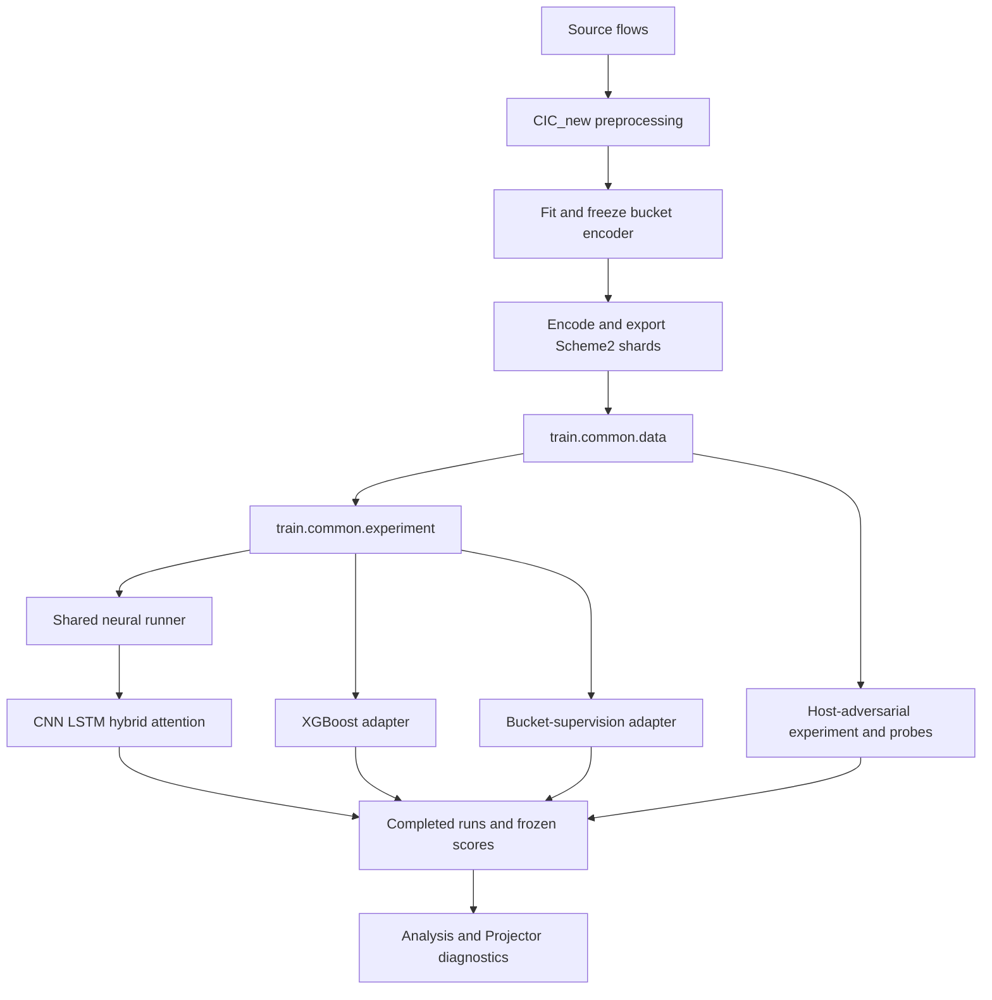

# Code Structure and Research Routing

Reviewed on 1 November 2026. This guide covers the implementation, rather than
the report figures and insertion drafts. The [research index](../research/README.md)
connects the same code to findings and evidence.

The inventory covers **113 source and configuration resources**, including
**102 Python modules**, **56 executable guards** and **259 static internal import
relationships**. These are structural counts, not counts of independent
experiments or successful executions.

- [CODE_INDEX.csv](CODE_INDEX.csv): every non-ignored Python, JSON configuration,
  requirements and PowerShell file under `CIC_new/`, `train/` and `analysis/`, with
  research category, role, definitions, imports, directly importing tests and hash.
- [MODULE_DEPENDENCIES.csv](MODULE_DEPENDENCIES.csv): resolved static internal imports.
- [INVENTORY_SUMMARY.json](INVENTORY_SUMMARY.json): inventory coverage and counts.
- [TEAM_CODE_PROVENANCE.json](TEAM_CODE_PROVENANCE.json): exact source/version of
  the restored seed-report helper.

## Implementation layers

| Layer | Location | Responsibility |
|---|---|---|
| Data construction | [CIC_new](../../CIC_new/README.md) | Source indexing, temporal grid, bucket statistics, split, training-only transforms and donor plan |
| Input representation | [representation_learning](../../CIC_new/representation_learning/README.md) | Fit the bucket autoencoder, freeze it and encode originals before vector superimposition |
| Shared detector runtime | [train/common](../../train/common/README.md) | Delivered data loading, weighting, model dispatch, optimizer loop, thresholds, evaluation and output helpers |
| Baseline architectures | [CNN](../../train/cnn/README.md), [LSTM](../../train/lstm/README.md), [hybrid](../../train/hybrid/README.md), [XGBoost](../../train/xgboost/README.md) | Model implementations, fixed configurations and thin training entry points |
| Targeted model extensions | [Attention](../../train/lstm_context/README.md), [bucket supervision](../../train/lstm_bucket/README.md), [host adversarial](../../train/lstm_host_adversarial/README.md) | Explicit extensions of the original LSTM and their specialized fitting/probe code |
| Experiment drivers | `train/run_*.py` | Matched-reference checks, new-run creation, fitting orchestration and paired result summaries |
| Diagnostics | [analysis](../../analysis/README.md), `train/audit_*.py`, `train/diagnose_*.py`, `train/export_*.py` | Raw-flow audits, feature probes, context interventions, representation exports and post-fit geometry |
| Implementation checks | `CIC_new/tests/`, `train/tests/` | Artificial-fixture checks for construction, models, policies and experiment mechanics |

The CSV records static imports. Architecture dispatch also uses
`importlib.import_module(f"train.{name}.model")` in
`train/common/torch_runner.py`; `train/common/experiment.py` selects the XGBoost,
shared neural or bucket-supervision adapter. The host experiment has a separate
fitting loop. These dynamic relationships are described here rather than counted
as static import edges.

## Report to implementation

| Research | Main code | Supporting code or protocol |
|---|---|---|
| Data and Scheme 2, sections 3-4 | `CIC_new/prepare_scheme2_dataset.py`, `preprocessing/`, `representation_learning/` | [Construction protocol](../../CIC_new/SCHEME2_DATASET.md); original Scheme 1/AE work is retained in the local historical archive |
| Detector comparison and rotation, 5.2 | `train/{cnn,lstm,hybrid,xgboost}/`, `train/run_circular_shift*.py` | `analysis/compare_circular_shift_results.py`; [five-seed guide](../../train/CIRCULAR_SHIFT_MULTISEED.md) |
| Attack profiles, 5.3 | `train/diagnose_lstm_attack_overlap.py`, `train/report_attack_types.py`, `train/export_projector.py` | Native-dimensional statistics and Projector exports are separate outputs |
| Host information, 5.3 | `train/run_lstm_host_adversarial.py`, `train/lstm_host_adversarial/` | [Host protocol](../../train/lstm_host_adversarial/README.md) |
| Web/context availability, 6.1 | `analysis/diagnose_web_temporal_structure.py`, `train/diagnose_window_context.py` | Availability diagnostics do not fit expanded-window detectors |
| Temporal geometry, 6.1 | `CIC_new/run_temporal_ablation.py`, `train/run_temporal_lstm.py`, `train/common/temporal_experiment.py` | [LSTM protocol](../../train/TEMPORAL_LSTM.md); CNN driver is a separate optional study |
| Input ambiguity, 6.2 | `train/audit_pure_infilteration.py`, `train/audit_infilteration_label_conflicts.py`, `train/inspect_infilteration_space.py` | Exact-input, raw-label and training-reference diagnostics have different scopes |
| Context and attention, 6.3 | `analysis/diagnose_lstm_context.py`, `train/run_lstm_context_ablation.py`, `train/lstm_context/model.py` | [Context protocol](../../train/LSTM_CONTEXT_ABLATION.md) |
| Distribution statistics, 6.3 | `analysis/audit_infilteration_features.py`, `analysis/recheck_infilteration_feature_probes.py`, `CIC_new/prepare_distribution_features.py`, `train/run_distribution_feature_ablation.py` | [Feature audit](../../analysis/INFILTERATION_FEATURE_AUDIT.md), [extension protocol](../../train/DISTRIBUTION_FEATURE_ABLATION.md) |
| Changed-case mixing, 6.3 | `analysis/inspect_distribution_infilteration_cases.py`, `analysis/review_distribution_feature_results.py` | Oracle interventions preserve original thresholds and do not establish calibrated improvements |
| Bucket supervision, 6.3 | `train/run_lstm_bucket_ablation.py`, `train/lstm_bucket/` | [Bucket protocol](../../train/LSTM_BUCKET_SUPERVISION.md) |
| Training exclusions, 6.4 | `train/seed_report.py`, `train/export_holdout_lstm_projector.py`, `train/export_flooding_projector.py`, `train/diagnose_flooding_projector.py` | [Version and reproduction boundaries](../../train/TRAINING_EXCLUSIONS.md) |

## Entry point and version decisions

Existing script/module paths are retained because tests import their functions,
experiment drivers call shared runtime modules, and completed-run manifests record
source hashes. A model directory by itself does not contain the shared runtime.
Run the documented entry points from the full repository root.

`train/lstm_context/` is the attention model implementation; it is not a second
baseline LSTM. `train/lstm_bucket/runner.py` implements the auxiliary loss;
`train/lstm_bucket/train.py` is its direct shared-runtime entry point, while
`train/run_lstm_bucket_ablation.py` adds matched-reference experiment checks.
`train/run_temporal_cnn.py` is an optional earlier model-family study, not a
duplicate of the selected LSTM experiment.

The seed-report code was restored **without modification** from the team's
committed snapshot. The team's holdout-construction command belongs to commit
`44ef865be777140b1ba34e7b0abe4ec156ea8708`. The current working-tree
`CIC_new/prepare_scheme2_dataset.py` does not expose that revision's
`--holdout-train-attacks` interface, and `train/unseen_subtype_report.py` is not
present in this tree. The delivered holdout datasets, committed summaries and
local geometry diagnostics remain distinct from a complete reconstruction of
the team's three-seed pipeline. Raw three-seed predictions are still required to
recompute Table H1.

Several diagnostic scripts import CSV writing or verification helpers from an
experiment driver. The dependency CSV records this existing coupling explicitly;
it was not silently changed during source organization. No original training,
model, preprocessing or diagnostic implementation was rewritten.

## Local outputs and verification scope

Datasets, model weights, prediction arrays, caches, complete runs, rendering
artifacts and historical working bundles are ignored. Configurations,
requirements, executable source and implementation tests stay shareable.
Artificial fixtures and CLI/import checks verify software behavior, not attack
detection results. This organization adds no trained model or experimental metric.

The source inventory and all listed static dependency paths were checked, along
with 227 navigation links across the code and research guides. All 132 original
runtime/support files from the preceding organization remain byte-identical.
The restored seed helper passed CLI help, paired aggregation on tiny temporary
saved-prediction fixtures, refusal to overwrite an existing output, and rejection
of mismatched prediction populations. These checks do not independently reproduce
the team's three-seed detection results.
